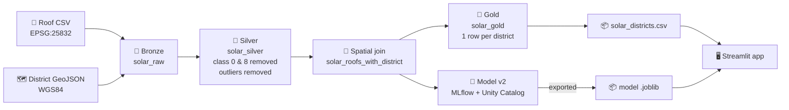

<div align="center">

# ☀️ SolarScope Hamburg

### 864,358 roofs. 103 districts. One question:
## *Where should Hamburg put solar panels first?*

**👉 [Try the live app](https://solarscopehamburg-o97rjf53ukjsbdkgzyzcqe.streamlit.app/)**: check your own roof in 10 seconds

`PySpark` · `Databricks` · `shapely` · `scikit-learn` · `MLflow` · `Unity Catalog` · `Streamlit`

</div>

---

## 🏙️ If Hamburg were 100 roofs

```
🟩🟩🟩🟩🟩🟩🟩🟩🟩🟩
🟩🟩🟩🟩🟩🟩🟩🟩🟩🟩
🟩🟩🟩🟩🟩🟩🟩🟩🟩🟩     🟩 53 roofs are suitable  (Eignung 1–3)
🟩🟩🟩🟩🟩🟩🟩🟩🟩🟩     ⬜ 47 roofs are not
🟩🟩🟩🟩🟩🟩🟩🟩🟩🟩
🟩🟩🟩⬜⬜⬜⬜⬜⬜⬜
⬜⬜⬜⬜⬜⬜⬜⬜⬜⬜
⬜⬜⬜⬜⬜⬜⬜⬜⬜⬜
⬜⬜⬜⬜⬜⬜⬜⬜⬜⬜
⬜⬜⬜⬜⬜⬜⬜⬜⬜⬜
```

**The twist:** those 53 suitable roofs hold **90% of all the solar power**.
A city programme does not need to convince every homeowner. It needs to find
the *right* half. That is what this project does.

---

## 🏡 vs 🏭 A tale of two roofs

| | 🏡 Average roof face in **Blankenese** | 🏭 Average roof face in **Altenwerder** |
| --- | --- | --- |
| Usable PV area | ~18 m² | ~453 m² |
| Potential peak power | **~2.7 kWp** | **~42.4 kWp** |
| Share of roof faces suitable | 37% | 57% |
| Roof faces in the district | 13,748 | 1,549 |

**One roof face in the port district Altenwerder ≈ 16 roof faces in Blankenese.**

The districts with the biggest average roofs are port and industrial areas
(Altenwerder, Kleiner Grasbrook, Waltershof, Billbrook). The smallest are leafy
residential ones (Blankenese, Tatenberg, Wohldorf-Ohlstedt, Rissen, Nienstedten).

> ⚠️ The data shows *that*, not *why*. Big warehouse roofs and tree shading are my
> hypotheses. The model below gives a hint, but no proof.

---

## 🧭 What the model learned: a homeowner's cheat sheet

I asked the trained model *"what decides if a roof is suitable?"*, and then
tested it with hundreds of what-if roofs. This is what it learned from
694,689 real Hamburg roof faces.

### What matters (feature importance)

```
Shading      ██████████████████████████████████████████████████████████▌ 59.5%
Direction    ████████████████████████▌                                   24.5%
Tilt         █████████▋                                                   9.7%
Roof type    ███▍                                                         3.4%
Roof size    ██▍                                                          2.4%
District     ▎                                                            0.3%
```

**Size barely matters for *suitability*.** The class is about how much sun a
square metre gets, not how many square metres you have. (Size matters a lot for
*how much power* you get, which is what the calculator handles.)

### The roof compass

For an example roof (100 m², 35° tilt, no shading), the predicted class by
direction:

```
                     N (0°)
                 🟥 marginal (6)
        NW 🟥                     NE 🟥
                                            🟥 = Eignung 6  marginal
  W (270°) 🟨 3        🏠        🟨 3 E (90°)  🟨 = Eignung 3  suitable
       WSW 🟩 2                 🟩 2 ESE    🟩 = Eignung 2  highly suitable
                                            ⭐ = Eignung 1  very suitable
        SW ⭐                     SE ⭐
                    ⭐ S (180°)
```

| Faces… | Prediction |
| --- | --- |
| 125° – 235° (SE → S → SW) | ⭐ Eignung 1 |
| 100° – 120° and 240° – 265° | 🟩 Eignung 2 |
| 75° – 95° (east) and 270° – 285° (west) | 🟨 Eignung 3 |
| below 75° or from 290° (north side) | 🟥 Eignung 6 |

### The shading cliff ✂️

Same example roof, facing south, with more and more shade:

```
 0% ─────── 7%   8% ──── 16%   17% ── 20%   21% ─────────────────── 100%
 ⭐ class 1      🟩 class 2     🟨 class 3     🟥 class 6 (marginal)
```

**At about 21% shading, a perfect south roof drops straight to "marginal".**

### Three more things the model says

- 📐 **Steep roofs:** on the example roof, from **41° tilt** the prediction
  becomes marginal (6).
- 🏢 **Flat roofs with panels on racks** (*Aufständerung*) are predicted
  **Eignung 1 facing any direction**, because the racks can point the panels south.
- 📍 **Your district doesn't decide it:** the same south roof gets the
  **same class in all 103 districts**, and so does the same shaded east roof.
  The model learned roof physics, not postcodes. That is exactly what the
  district-based test split was meant to force.

> 🔍 **Honest fine print:** these are the model's answers around *one*
> example roof, not physical laws. And even for the "perfect" south roof, the
> model gives class 1 only **38%** probability. It is less sure than its
> single answer suggests.

---

## 📊 The leaderboard

Potential peak power by district (top 10, MWp):

```
Wilhelmsburg  ███████████████████████████████████████████████ 235.7
Rahlstedt     █████████████████████████████████████████████   225.7
Bramfeld      ███████████████████████████▌                    137.6
Billstedt     ███████████████████████████▍                    136.8
Langenhorn    ██████████████████████████                      130.1
Niendorf      ████████████████████████▎                       121.7
Bahrenfeld    ████████████████████████▎                       121.5
Billbrook     ████████████████████████                        119.8
Bergedorf     ██████████████████████▍                         111.8
Wandsbek      ███████████████████▊                             99.2
```

**The top 10 hold only 27% of the total.** Half of Hamburg's potential needs
**26 districts**, and 80% needs **57**. Solar here is a whole-city job.

---

## ⚡ The "what if" number

What if *every suitable roof* got panels? Using the app's own rules of thumb
(950 kWh per kWp per year, 0.4 kg CO₂ per kWh):

| | |
| --- | --- |
| Suitable peak power | ≈ 4,888 MWp |
| Yearly production (rough) | **≈ 4.6 TWh** |
| CO₂ avoided per year (rough) | **≈ 1.9 million tonnes** |

> A back-of-the-envelope ceiling, not a forecast. It ignores cost, ownership,
> monument protection, grid limits and whether owners want panels at all.

---

## 🗺️ How 864,358 rows become one answer



**The hard part nobody sees:** roofs and districts came in two different
coordinate systems (metres vs degrees). I reprojected the 104 district polygons
(not the 864k roofs), took each roof's centre point, and matched it with a
spatial index (`shapely.STRtree`). Roofs whose centre lands exactly on a border
get the nearest district within 500 m.

---

## 🤖 The model that had to unlearn cheating

| | 🙈 v1 | ✅ v2 (in the app) |
| --- | --- | --- |
| Algorithm | HistGradientBoosting | Random Forest (100 trees, depth 12) |
| Radiation columns as input? | **yes** (`schattena`, `percentmsa`) | **no** |
| Test set | random 80/20 split | **21 whole districts it never saw** |
| Train / test roofs | — | **694,689 / 169,669** |
| Result | — | **accuracy 0.88 · macro F1 0.863** |

**Why v1 had to go:** the suitability class is basically *computed from*
radiation. v1 was revising with the answer sheet on the desk, and the random
split let it "recognise" neighbourhoods.

v2 only uses what a homeowner knows *before* a solar study:
**size · direction · tilt · shading · roof type · district.**
The training data contains four classes: Eignung **1, 2, 3 and 6**.

---

## 🖥️ The app

| Page | For whom | What you get |
| --- | --- | --- |
| 🗺️ **Map** | anyone curious | district bubble map, headline numbers, ranking |
| 🏠 **My roof** | a homeowner | predicted class + rough kWp, kWh/year, € saved, CO₂ avoided |
| 📊 **Insights** | a planner | suitable share, top-15 chart, suitable vs total, best districts |

**One app, two homes:**

```
            ┌── on Databricks ───────► model from Unity Catalog (MLflow)
My roof ────┤
            └── on Streamlit Cloud ──► same model, bundled as
                                       assets/solar_suitability_model.joblib (11.6 MB)
```
### Run it yourself

```bash
cd solar-suitability-predictor
pip install -r requirements.txt
streamlit run Home.py
```

All three pages work locally, with no Databricks account needed.

---

## 📁 Repository

```
.
├── Data Ingestion Bronze Table (Raw data).ipynb   # pipeline + both models (Databricks)
├── solar-suitability-predictor/
│   ├── Home.py                  # entry point
│   ├── app.py                   # legacy stub, kept so old links don't break
│   ├── app.yaml                 # Databricks App start command
│   ├── requirements.txt
│   ├── assets/
│   │   ├── solar_districts.csv              # Gold-table export (103 districts)
│   │   └── solar_suitability_model.joblib   # model v2 for Streamlit Cloud
│   └── pages/  1_Map.py · 2_My_Roof.py · 3_Insights.py
├── Learning_log.md              # what I learned, told as plot twists
└── README.md
```
## 📂 Data

- `de_hh_up_dachseiten_EPSG_25832.csv`: Hamburg solar potential analysis, one row per roof face
- `hamburg_city_districts.geojson`: Hamburg district boundaries
---

<div align="center">

*Next stop: from Hamburg to all German states.* 🇩🇪

</div>
