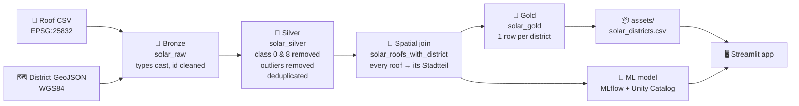

<div align="center">

# ☀️ SolarScope Hamburg

### 864,358 roofs. 103 districts. One question:
## *Where should Hamburg put solar panels first?*

`PySpark` · `Databricks` · `shapely` · `scikit-learn` · `MLflow` · `Unity Catalog` · `Streamlit`

</div>

---

## 🏙️ If Hamburg were 100 roofs

Picture the whole city shrunk to **100 roofs**. This is what my data says
about them:

```
🟩🟩🟩🟩🟩🟩🟩🟩🟩🟩
🟩🟩🟩🟩🟩🟩🟩🟩🟩🟩
🟩🟩🟩🟩🟩🟩🟩🟩🟩🟩     🟩 53 roofs are suitable  (Eignung 1–3)
🟩🟩🟩🟩🟩🟩🟩🟩🟩🟩     ⬜ 47 roofs are not
🟩🟩🟩🟩🟩🟩🟩🟩🟩🟩
🟩🟩🟩⬜⬜⬜⬜⬜⬜⬜
⬜⬜⬜⬜⬜⬜⬜⬜⬜⬜
⬜⬜⬜⬜⬜⬜⬜⬜⬜⬜
⬜⬜⬜⬜⬜⬜⬜⬜⬜⬜
⬜⬜⬜⬜⬜⬜⬜⬜⬜⬜
```

**The twist:** those 53 suitable roofs hold **90% of all the solar power**.
Half the roofs carry almost all the potential, so a city programme does not
need to convince every homeowner. It needs to find the *right* half.

That is what this project does.

---

## 🏚️ vs 🏭 A tale of two roofs

| | 🏡 An average roof face in **Blankenese** | 🏭 An average roof face in **Altenwerder** |
| --- | --- | --- |
| Usable PV area | ~18 m² | ~453 m² |
| Potential peak power | **~2.7 kWp** | **~42.4 kWp** |
| Share of roof faces suitable | 37% | 57% |
| Roof faces in the district | 13,748 | 1,549 |

**One roof face in the port district Altenwerder has the potential of about
16 roof faces in Blankenese.**

The four districts with the biggest average roofs are all port or industrial
areas: Altenwerder, Kleiner Grasbrook, Waltershof and Billbrook. At the other end are leafy
residential districts: Blankenese, Tatenberg, Wohldorf-Ohlstedt, Rissen and
Nienstedten.

> ⚠️ The data shows *that* this is the case, not *why*. Big logistics and
> warehouse roofs, and tree shading in the villa districts, are my
> hypotheses. I have not tested them yet (see [LEARNING.md](LEARNING.md)).

*City average: ~6.3 kWp per roof face.*

---

## 📊 The leaderboard

Potential peak power by district (top 10, MWp):

```
Wilhelmsburg  ███████████████████████████████████████████████ 235.7
Rahlstedt     █████████████████████████████████████████████   225.7
Bramfeld      ███████████████████████████▌                    137.6
Billstedt     ███████████████████████████▍                    136.8
Langenhorn    ██████████████████████████                      130.1
Niendorf      ████████████████████████▎                       121.7
Bahrenfeld    ████████████████████████▎                       121.5
Billbrook     ████████████████████████                        119.8
Bergedorf     ██████████████████████▍                         111.8
Wandsbek      ███████████████████▊                             99.2
```

But the leaderboard is misleading in one way. **The top 10 hold only 27% of
the total.** Reaching half of Hamburg's potential takes **26 districts**, and
reaching 80% takes **57**. Solar in Hamburg is a whole-city job, not a few
neighbourhoods.

---

## ⚡ The "what if" number

What if *every suitable roof* got panels? Using the same rules of thumb as the app
(950 kWh per kWp per year in Hamburg, 0.4 kg CO₂ per kWh for the German grid mix):

| | |
| --- | --- |
| Suitable peak power | ≈ 4,888 MWp |
| Yearly production (rough) | **≈ 4.6 TWh** |
| CO₂ avoided per year (rough) | **≈ 1.9 million tonnes** |

> This is a back-of-the-envelope ceiling, not a forecast. It ignores
> cost, ownership, monument protection, grid limits and whether owners want panels at all.

---

## 🗺️ How 864,358 rows become one answer



### The hard part nobody sees: putting each roof in the right district

The roofs and the districts came in **two different coordinate systems**:
metres (EPSG:25832) and degrees (WGS84). Before they can be matched, they have to
speak the same language. So I:

1. reprojected the **104 district polygons** (not the 864k roofs, which is much cheaper)
2. turned every roof into its **centre point**
3. used a **spatial index** (`shapely.STRtree`) to drop each point into its district
   in one vectorised step
4. gave roofs whose centre lands *exactly on a border* to the **nearest district within 500 m**
5. checked the result: every roof gets exactly one district

---

## 🤖 The model that had to unlearn cheating

**Task:** a homeowner enters what they know about their roof → the model
predicts the official suitability class (Eignung 1 / 2 / 3 / 6).

The model has two versions, and **v2 exists because v1 was too good to be honest:**

| | 🙈 v1 | ✅ v2 (in the app) |
| --- | --- | --- |
| Algorithm | HistGradientBoosting | Random Forest (100 trees, depth 12) |
| Saw radiation columns? | **Yes** (`schattena`, `percentmsa`) | No |
| How it was tested | random 80/20 split | **21 districts it had never seen** |
| What went wrong | The suitability class is basically *computed from* radiation, so v1 had the answer sheet on the desk. A random split also let it "recognise" neighbourhoods. | — |

v2 only gets what a homeowner knows *before* any solar study:
**size · direction · tilt · shading · roof type · district.**

**Reported v2 result** (from the app's Home page): **88% accuracy, 0.86 macro F1**
on unseen districts. Registered as `workspace.default.solar_suitability_model` v2.

---

## 🖥️ The app: three doors

| Door | For whom | What you get |
| --- | --- | --- |
| 🗺️ **Map** | anyone curious | bubble map of all districts, headline numbers, full ranking |
| 🏠 **My roof** | a homeowner | predicted suitability class + rough kWp, kWh/year, € saved, CO₂ avoided |
| 📊 **Insights** | a planner | suitable share, top-15 chart, suitable vs total, districts with the best share |

The "My roof" calculator openly states its rules of thumb (6 m²/kWp, 950 kWh/kWp/year,
0.4 kg CO₂/kWh) and says it's a rough estimate, not a quote.

### Run it

The app is configured as a **Databricks App** (`app.yaml` → `streamlit run Home.py`).

```bash
cd solar-suitability-predictor
pip install streamlit pandas mlflow scikit-learn
streamlit run Home.py
```

- **Map** and **Insights** read only the small CSV in `assets/`, so they work anywhere.
- **My roof** loads the model from Unity Catalog, so it needs Databricks access.
  Without access the page shows a clear error instead of crashing.

---

## 🧭 Choose your path through this repo

- **⏱️ 2 minutes?** Read the top of this page and open the app.
- **🔬 A data person?** Open the notebook `Data Ingetion Bronze Table (Raw data).ipynb`,
  from cell 13 (cleaning) to cell 16 (spatial join) to cell 25 (model v2).
- **🧑‍💼 A recruiter?** [LEARNING.md](LEARNING.md) has the decisions, the mistakes and
  what I'd do differently.

```
.
├── Data Ingetion Bronze Table (Raw data).ipynb   # pipeline + ML (Databricks)
├── solar-suitability-predictor/
│   ├── Home.py              # entry point
│   ├── app.py               # legacy, kept so old links don't break
│   ├── app.yaml             # Databricks App start command
│   ├── requirements.txt
│   ├── assets/solar_districts.csv
│   └── pages/  1_Map.py · 2_My_Roof.py · 3_Insights.py
├── LEARNING.md
└── README.md
```

---

## 🧾 Honesty corner: what this repo does *not* (yet) show

- The **raw data** lives in a Databricks Volume, not in this repo.
- The notebook **logs and registers v1** to MLflow. The cell that registers **v2**
  is not committed, and the notebook outputs were not saved, so the 88% / 0.86
  figures come from the app text.
- The Home page says the model was "trained on 864,358 roof faces". That is the
  full cleaned dataset. With the district split, training uses roughly 80% of districts.
- The Home page calls the Bronze table `solar_raw_csv`, but the notebook saves it as `solar_raw`.
- On "My roof", moving the price slider makes the results disappear until you
  click the button again (Streamlit reruns the script).
- The "What if" numbers above are rough rule-of-thumb maths.

## 📂 Data

- `de_hh_up_dachseiten_EPSG_25832.csv`: Hamburg solar potential analysis, one row per roof face
- `hamburg_city_districts.geojson`: Hamburg district boundaries

<!-- TODO: add exact download links + licence -->

---

<div align="center">

*Next stop: from Hamburg to all German states.* 🇩🇪

</div>
